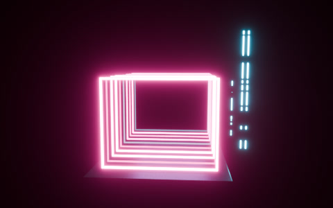

# Afterglow 0.21

**Music in. Finished visual out.**

Audio-reactive lighting for Blender 5.2+. Pick a scene and a look, then let Afterglow
handle calibration, smooth playback, lighting, glow and camera setup.

## Start in three steps

1. **Choose a scene:** Orbit Stage, Equalizer Wall or Neon Tunnel.
2. **Choose music and a look.** Leave music empty to try the included demo beat.
3. Press **Create Visual**, then **Space** to preview.

Change the music or look and press **Update Visual**. It refreshes the whole show.
There are no separate calibration, baking, lighting-build or glow setup steps.

Afterglow reuses the selected collection. Advanced Controls lets you use your own
emissive objects or explicitly add another stage. New stages select their generated
camera; existing custom-scene cameras remain under your control.

## Export in one action

Choose **Video Shape**, set **Save To**, then press **Export Video**.

Afterglow prepares MP4 with audio, fits the generated camera to the chosen shape,
and renders the whole track with a short fade-out. Landscape, portrait and square
presets keep the existing frame rate. A custom user camera is never reframed.

Save your `.blend` first to use the default `//afterglow-output/` folder, or choose
an absolute folder path. Folder exports use a new filename when one already exists;
explicit existing MP4 filenames are protected. Rendering runs in Blender's native
progress/cancellation interface.

## Install

1. Download [afterglow-0.21.0.zip](dist/afterglow-0.21.0.zip).
2. In Blender 5.2+, open **Edit → Preferences → Get Extensions → Install from Disk**
   and choose the ZIP.
3. Open the 3D Viewport sidebar (`N`) and select **Afterglow**.

The add-on runs locally. No account or network service is required. The demo beat
is original synthesized audio packed into the project.

## Need more control?

Turn on **Advanced Controls**. Individual effects, custom look libraries, object
settings, manual build tools and PNG export are kept there.

[Advanced guide and development commands](docs/advanced.md) · [License](LICENSE)
