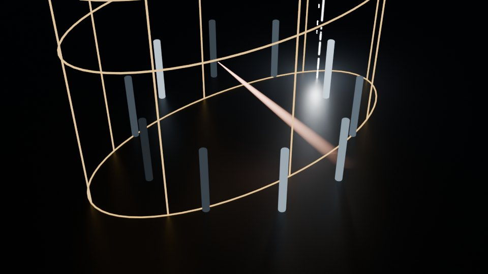
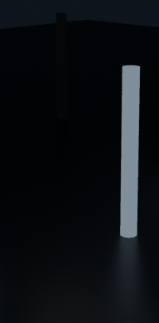

# Advanced controls

Enable **Advanced Controls** at the bottom of the Afterglow panel to see manual
scene setup, individual lighting layers, per-object response, custom looks and
render settings. Ordinary use only needs Create Visual and Export Video.

## Where the manual tools live

- **Custom Scene & Timing:** choose an existing collection, use selected objects,
  add a different starter stage, offset the song or change automatic glow.
- **My Looks:** save a snapshot, import/export JSON, or build a custom saved look.
  Snapshots capture layer styling and the first reacting object's shared look.
- **Ripple Motion:** choose direction and surface travel.
- **Manual Build & Cleanup:** build reactions separately, apply look settings,
  calibrate, redistribute bands, refresh playback, or remove reactions.
- **Advanced Lighting:** edit the eight layers, venue, beam appearance, solo and
  brightness. Render Finish exposes the compositor glow controls.
- **Export:** advanced mode exposes PNG sequences, excerpt loops, manual render
  ranges, camera fitting and explicit output preparation.

Existing saved projects, custom look files and scripting operator IDs are retained.
Commands below run from the repository root.

## Scene controls

| Control | What it does |
|---|---|
| Ripple | Every kick sweeps across the collection by position instead of lighting everything at once. The sweep follows the song's detected tempo. |
| Beats per Sweep | How many beats one sweep takes to cross the collection. |
| Ripple From | Where the sweep starts: Longest Axis, X, Y, Z, an **Empty** (outward from an Origin object), or the Collection Center. Reverse flips it. |
| Through Objects | The wave crosses each object's surface pixel by pixel instead of lighting the whole object at once. Needs Fast Playback. |
| Fast Playback | Precomputes the reaction with numpy and keys it, so playback never evaluates Blender's slow Sample Sound node. Settings changes re-bake automatically once you stop dragging; after editing bands, Decay or Delay in the modifier, use the *Re-bake* button the panel shows. |
| Re-spread | Spreads bands bass → treble again across objects without **Lock Band**, and picks up moved objects or a moved Origin. |

## Per-object controls

Select an Afterglow object to tune it in the panel. Its box follows the order you tune in:

| Group | Control | What it does |
|---|---|---|
| Band | Low / High | The frequency band (Hz) this object listens to. |
| Band | Lock (padlock) | Keep this object's band when re-spreading. |
| Response | Gain / Threshold | Level = (amplitude − Threshold) × Gain. While Ripple is on, the kick band's own Ripple Gain / Ripple Threshold pair is shown instead. |
| Response | Decay | How long a peak takes to fade (seconds). |
| Response | Delay | Shift this object's reaction later in time (seconds). |
| Look | Intensity | Emission brightness multiplier. Unlike Gain it leaves the colour mix and Level Meter fill alone. |
| Look | Glow | Idle glow: brightness never drops below this level, so quiet parts glow dimly instead of going black. |
| Look | Use Colors / Color A / Color B | Tint from Color A (quiet) to Color B (loud). |
| Look | Level Meter | Fill the object along an axis by loudness, like an equalizer bar (off while Through Objects is on). |

The Ripple settings live in their own collapsible **Ripple** section under Fast Playback.

## Environment Effects

Audio-only environment effects for the whole venue: independent, stackable light layers
triggered by onsets in the track. Most layers generate **real lights only**
(point and spot lamps with keyed energy, location and rotation). Opt into
**Visible Beams** for shafts or **Signal Graphics** for travelling lines and arrival
frames. **Laser Fans** includes thin emissive rays so it works without fog. Generated
objects live in a separate removable collection; the source venue stays unchanged.

### Layers

| Layer | What it does | Default trigger band |
|---|---|---|
| Data Strikes | Spots that snap on over the venue top and shine straight down for ground spill | Low |
| Data Blooms | Soft pulses of light that swell and fade inside the venue | Low |
| Rapid Flashes | Very short whole-venue bursts from the centre | Low |
| Travelling Light Trails | A bright moving light riding the venue rim path | Low |
| Cascade Trails | A trail of lights travelling one line: down, up, or along the camera's view | Low |
| Gun Bursts | Short, fast, directed spots fired from the rim toward the centre | Low |
| Signal Network | A light pulse travels through connected anchors and triggers an arrival flash | Low |
| Laser Fans | Paired fans of thin visible rays sweep across the stage on each attack | Low |

Layers are **not** a dropdown: enable any combination and they play simultaneously.
Each layer has its own Weight, Intensity, Color (each layer starts in its own colour),
Timing and Trigger Band. The floats are
keyframeable on the Scene, and Build samples their animation per event, so you can bring
layers in gradually as the track builds (e.g. keyframe Weight 0 → 1).

### Laser Fans

Choose **Laser Show** and **Create Visual** for the complete look. In Advanced Lighting,
**Laser Fans** can also be combined with any other layer. Each attack opens a pair of
sweeping fans from the venue rim. Thin native emissive curves make the rays visible in
EEVEE and Cycles without fog or the Visible Beams switch. Silence stays dark.

**Rays per Fan**, **Spread** and **Sweep** change the fan shape and movement; rebuild
after editing them. **Glow**, layer **Color** and **Brightness**, and the shared live mix
update immediately. **Density**, **Listen to** and **Duration** work like the other
layers. The same audio, settings and Seed reproduce the same sweep. Custom saved looks
include the laser settings; older look files load with lasers disabled.

### Signal Network

Audio attacks launch a travelling light along a connected, right-angled route. The
arrival triggers a stronger flash; it is a consequence of the pulse reaching its
destination, not an unrelated random event. This layer uses three pooled real lights.

1. Enable **Signal Network**. With no **Signal Anchors** collection, four anchors are
   sampled from the shared venue outline, so it works without extra setup.
2. For a custom route, position the 3D cursor and press **+** beside **Anchors**. Add at
   least two anchors. Move, duplicate, delete or rename these non-rendering Empty
   markers normally: routing uses **name order and full world-space XYZ**, including
   parent transforms. You can also pick an existing collection of anchor objects.
3. Pick **Chain** to pass through every anchor, or **Spokes** to send successive attacks
   from the first anchor to each destination in turn. **Forward**, **Reverse** and
   **Alternate** control travel direction; Reverse retraces the same route. **Speed**
   sets scene units per second; layer **Timing** multiplies the travel duration.
4. Optionally enable **Signal Graphics**, then **Build Effects**. This is **off by
   default**, independent of Visible Beams. It adds thin native emissive curves: a
   moving pulse with a **Tail Length**, plus broken rectangular frames that reveal,
   expand and fade on arrival. **Line Width**, **Frame Size** and **Signal Glow** shape
   the look. Signal Glow, Color and Intensity are live; routing/geometry edits need Build.

**Surface Impacts** ray-casts below the destination against evaluated, renderable scene
geometry. When a surface is found, the pulse descends to it and the arrival frame aligns
to its normal, just above the surface. A miss leaves the destination floating: no flat
ground is invented. Turn this off for upright floating signal frames. The source venue
and its materials are never edited; Remove Effects deletes owned lights, curves,
materials and actions, but **keeps your anchor markers**.

Anchors and surfaces are sampled at the **build frame**, not followed live. Rebuild
after moving anchors or editing terrain. Moving anchors and changing network controls
mark the build outdated; arbitrary terrain edits are not automatically detected. The
connections are orthogonal, not obstacle-avoiding or surface-conforming routes, and
can cross existing scenery. Spokes are sequential, not simultaneous branching. Up to
16 anchors and three simultaneous pulses are supported; when the pool is full, the
oldest pulse fades out before its slot is reused. Graphics are pooled per used route
and direction, not spawned every frame. Silence produces no signals or graphics.

### Venue shapes

`Venue Shape` routes emitters in world space over the shared venue bounds (fitted to the
Afterglow collection, never per object):

- **Circular**: trails ride a circle; spawns fill the disc.
- **Square**: trails ride a square rim; spawns fill the square.
- **Rectangular**: trails ride the venue bounds' own rectangle.
- **Triangular**: trails ride a triangle; spawns fill the triangle.

### Emitter cage



By default the venue is fitted to the collection (with **Height** and **Margin**). For
direct control, press **Add Cage**: Afterglow adds an **Afterglow Emitter** object, a
wireframe outline of the venue (its floor, its top, the ring trails ride and a few
posts), fitted to exactly the venue you had. Then shape it in the viewport:

- **Move** it to move the venue; its origin sits on the venue floor.
- **Turn** it about Z to turn the venue (X and Y rotation are locked).
- **Scale** X and Y to size the footprint (unequal scale makes an ellipse or rectangle),
  and Z to set the height.

Effects spawn and travel inside it. Your changes are kept: applying its scale (Ctrl+A) or
resizing it in Edit Mode works too, and changing **Venue Shape** redraws it at the same size
and place. It never renders, Build, Remove Effects, Apply and Remove leave it alone, and
moving it marks the build outdated. The refresh button beside it snaps it back to the
collection (it asks first); delete it to go back to the fitted venue.

### Cascade Trails

Each Cascade Trail event sends **Count** lights along one line, **Spacing** apart, each
fainter than the one ahead. **Direction** picks the line:

- **Down** / **Up**: from the venue top to the floor, or back up. **Placement** runs it
  at a random spot inside the venue, or always through the **Center**.
- **To Camera**: from the first surface the active camera looks at, straight down its
  view axis to just in front of the lens. Point the camera up a shaft and the light falls
  toward the lens and floods the frame. **From Camera** runs the other way.

Camera cascades follow a moving camera: each event uses where the camera is at that
event's frame. Build needs an active scene camera for them, and re-keying the camera marks
the build outdated. **Size** is each light's radius: larger gives softer spill.

### Strike points

Data Strikes land at random spots inside the venue by default. To place them yourself, set
the Data Strikes layer's **Placement** to **Points** and press **Add Point**: Afterglow adds
a **Strike Point** at the 3D cursor, an arrow as tall as the venue standing on its floor,
showing where a strike will land. Move, duplicate or delete points like any object (only
their position on the floor counts), then Build Effects.

**Order** decides which point each strike lands on: **Sequence** goes through them one
after another in name order (rename them to choreograph), **Random** draws one per strike
(the same every build, from the Seed). The points live in an **Afterglow Strike Points**
collection; you can pick any other collection instead, and every object in it becomes a
point. Moving a point marks the build outdated; Build and Remove Effects never touch them.

### Visible Beams



Off by default. **Visible Beams** makes the strikes visible in the air, not just as spill
on surfaces:

- Each **Data Strike** becomes a thin, white-hot filament from the venue top to the floor,
  broken into short dashes (a different pattern per light) inside a faint glow. Its light
  moves down near the filament's base and becomes a point light, so it lights the floor
  and the sides of nearby objects from low down. A fainter filament of short bright
  beads runs beside it, covering only part of its height, on a side and stretch of its
  own per light.
- Each **Gun Burst** gets a glowing tracer that flies along its aim with a fading tail
  **behind** the moving light (never projecting ahead of it),
  and its spot tightens to the tracer's cone.

Beam controls:

**Strike Look** now has real silhouettes: **Filament** (one round core), **Twin** (two
parallel cores), and **Ribbon** (a flat strip). **Width** changes their thickness;
**Companions** adds zero to four beaded filaments, with **Spread** setting their distance
from the main strike. Strike height still reaches from the venue floor to its top.

**Gun Look** offers **Tracer**, **Dart** (wide shoulder near the head and a fine tail),
and **Streak** (thin, nearly constant width). **Length** and **Width** are independent
multipliers; **Taper** adjusts tail width and **Tail Fade** controls how quickly its
emission falls away. All three trail behind the actual moving light.

Each has its own **Variation**, default **0.35**. Every hit gets a fresh, seeded look,
even when it reuses the same pooled light: Strikes vary width, rotation, dash phase,
breakup and flow; Gun Bursts vary width, length and fade. Both vary brightness slightly.
**0** disables per-hit variation. The **Seed** in Venue reproduces the same show; change
it for a different result. Variation never changes onset times, placement or the number
of pooled objects, and a look stays fixed during a hit rather than flickering per frame.
New look controls need **Build Effects**; Glow, layer Color and Intensity remain live.
These controls affect only opt-in beam graphics and their paired light brightness,
never the shape or materials of your existing environment. The original per-object
**Look** section still controls object emission rather than deformation.

| Control | What it does |
|---|---|
| Glow | Brightness of all beams. |
| Flow, Direction | How fast the dashes and beads stream (0 holds them still), and whether **Down** or **Up**. |
| Gaps | How broken up the filaments are: 0 almost solid, 1 mostly gaps (the beaded companion is always a bit more broken up). |
| Dash Size | Length of the dash pattern's features, in metres. |
| Walk, Walk Time | How a Strike beam arrives: **Down** (default) grows it from the top so it lands on the floor exactly on the beat, then its tail follows it out; **Up** leaves the floor on the beat and grows to the top; **Off** shows it all at once. Walk Time is how many seconds the head takes to cross the height (the tail takes as long to leave), whatever the strike's length. |

The beams are emissive meshes parented to their lights, with brightness keyed on the same envelope as the light, so they look the same in
EEVEE and Cycles and cost almost nothing to render. They cast no shadows and light nothing
themselves (the lights do that). They're drawn as wireframes and can't be selected, so
they never hide or block your venue in the viewport, and Remove Effects deletes them with
the lights.

### Usage

1. Pick your Collection and Sound in the *Afterglow* panel as usual.
2. Open the *Afterglow Environment Effects* panel, choose the venue shape, enable layers,
   and set colours and bands.
3. **Build Effects** analyses the sound once, then keys pooled real point/spot lights into
   a collection named `Afterglow Effects` in the current scene (plus their beam meshes
   when Visible Beams is on, and thin curves for Laser Fans or Signal Graphics).
4. Scrub or play. The effects are plain F-curve animation on a layered action, so they
   render in any engine and never touch the Sample Sound node.
5. **Remove Effects** deletes this scene's effects collection and every datablock it owns
   (tagged `afterglow_effects`). Your objects, materials and animation, and other scenes'
   effects, are never modified.

After a build, each enabled layer shows how many events it fired; a red *0 events* means
its Trigger Band never hit, so try another band. Build Effects is grayed out while no
layer is enabled, so it never wipes your last build by accident.

### Audio timing

Environment events follow **rising attacks** in each band's amplitude, rather than
waiting for the loudest point of a whole passage. Repeated kicks can retrigger over a
sustained bass note; a held tone, a slow fade or silence does not create repeated beats.
The existing conservative beat-grid snapping still runs only when there is reliable
repeated timing evidence; this is not a new variable-tempo beat tracker.

**Timing Offset**, above the layer controls, shifts every environment event *after*
beat snapping. Negative values fire earlier; positive values fire later. It is in
seconds (`-0.025 s` advances the effects by 25 ms), defaults to zero, and is a static
setting: press **Build Effects** to apply it. It never moves the sound strip or the
existing emissive-object reactions. With an earlier offset, events can begin before
Start Frame: include that pre-roll in your playback/render range if you want to see it.
Shows built with the previous peak detector are marked outdated and need rebuilding.

**Live controls** need no rebuild: each layer's **Color** and **Intensity**, Cascade Trails
**Size**, the beams' **Glow**, **Signal Glow** and **Laser Glow** retune the last build the moment you change them (a
keyframed Intensity is the exception: Build samples it per event). Other settings do not
silently re-run: the panel shows *Build outdated* until you press Build again. The same sound, settings and Seed always produce the same show.

**v0.16.1 fixes:** short Timing values keep each light's attack before its hold and
fade-out, rather than leaving out-of-order brightness keys. Intensity 0 is fully dark
and can be raised again without rebuilding, even when the show was built at zero or
saved/reopened while muted. This applies to real lights, Visible Beams and Signal
Graphics and Laser Fans; animated Intensity is still sampled per event and needs Build. Rebuild older
shows to get these fixes and the corrected trailing Gun Burst geometry.

## Demo

Repeatable generator (synthetic pulse fixture track, circular pillar venue, all six
layers with Visible Beams, saved `.blend`, short sequential EEVEE motion proof). The
output folder after `--` is optional; it defaults to your temp folder's
`afterglow-effects-demo`:

```bash
blender -b --factory-startup --python-exit-code 1 --python tools/build_effects_demo.py -- <OUT>
# clip + contact sheet from the rendered frames:
ffmpeg -framerate 24 -i <OUT>/frames/%04d.png -c:v libx264 -pix_fmt yuv420p <OUT>/motion.mp4
ffmpeg -i <OUT>/frames/%04d.png -vf "select='not(mod(n,8))',scale=320:-1,tile=4x3" \
    -frames:v 1 <OUT>/contact_sheet.png
```

(`blender` is your Blender 5.2 executable, e.g.
`"C:/Program Files/Blender Foundation/Blender 5.2/blender.exe"` on Windows.)

## Tests

Each `tests/test_*.py` file is a standalone headless suite. Run one with Blender:

```bash
blender -b --factory-startup --python-exit-code 1 --python tests/test_effects.py
```

Or run them all without installing Blender, using the `bpy` module from PyPI (Python 3.13).
This is what CI does on every push:

```bash
python3.13 -m venv .venv && . .venv/bin/activate
pip install bpy==5.2.2
for t in tests/test_*.py; do python "$t" || break; done
```

On Linux without a GPU, render suites need Mesa's software OpenGL. Export tests also
use `ffmpeg` and `ffprobe` to verify encoded video and audio:

```bash
sudo apt install libegl1 libgl1-mesa-dri libglx-mesa0 ffmpeg
```

## Releasing

1. Bump `version` in `afterglow/blender_manifest.toml` (and the README title), and commit.
2. Tag the commit with that version and push the tag:

   ```bash
   git tag v0.15.0 && git push origin v0.15.0
   ```

[`release.yml`](../.github/workflows/release.yml) runs the full test suite, checks the tag
matches the manifest, builds the zip with Blender's own extension builder, and publishes
it as a GitHub Release.

## Limitations (honest)

- Generated effects add owned lights and optional graphics. Laser Fans includes ray
  curves; Signal Graphics and Visible Beams add their own curves or meshes. Build
  never edits your source objects, materials or World.
- Without Visible Beams, these layers have no visible "beam" or streak shape of their own:
  Strikes and Gun Bursts read as aimed spots, Cascade Trails as a cascade of travelling
  points of light. Visible Beams covers Strikes and Gun Bursts only.
- Beam meshes are glows, not volumes: they don't light fog, and objects in front of a
  beam don't shadow it. Seen from straight above or below, a strike filament is a dot.
- The effect timing and placement are an **interpretation** of the reference video's
  look (cool selective light in a dark venue).
- Effect lights have shadows disabled (dozens of shadow-casting lights would crawl); they
  provide environmental spill only, and their beams pass through objects.
- Keyframed layer controls are sampled **per event at Build time**: re-Build after
  animating Weight/Intensity/Timing (the *Build outdated* hint tracks their keyframes).
  The hint does not track moved venue objects.
- Event detection is onset-driven per trigger band and tempo-aware when the track
  provides enough repeated pulses to fit a reliable grid. Sparse, sustained, or ambiguous
  material stays onset-driven rather than forcing a guessed beat; silence produces no
  events.
- Pools are bounded (2–6 slots per layer; a Cascade Trail event uses a cascade of Count
  lights in one slot). When every slot is still lit, a new event takes over the one
  closest to finishing: that event fades out quickly and the new one starts cleanly,
  rather than spawning unbounded lights.
- Blender 5.2 crashes when the Sample Sound node evaluates a missing file, so Afterglow
  never hands a missing sound to its modifiers; relink or pack the sound instead.
